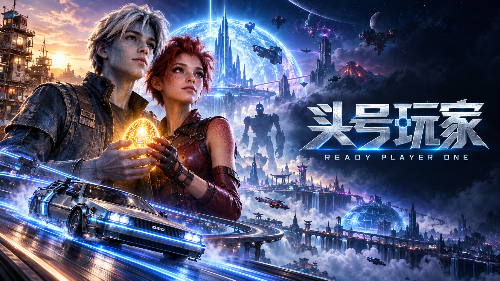

<a href="https://bopythonai.github.io/ready-player-one-reflections/">打开沉浸式阅读页面</a>

<a href="https://bopythonai.github.io/ready-player-one-reflections/3d-assets.html">3D资产</a>

这几天对挺感兴趣的，生成了一些有趣的，又是很巧，可能抖音过于强大，最近又刷到了电影《头号玩家》的片段，于是心血来潮，匆匆写点一些自己想法的Blog，再过十年，或许还能像朋友圈一样，看看当年（此刻一些稚嫩的想法）。。。。。

以前看这部电影，更多是被里面的 OASIS 所吸引。戴上设备，就能进入另一个几乎没有边界的世界，在那里探索、冒险，甚至过上与现实完全不同的生活。前阵子和  聊起这部电影，突然觉得，《头号玩家》或许是人类提前写给2050年，甚至2100年时代的一封情书。

只是这封信究竟什么时候能收到回音，谁也说不准。

有意思的是，最近在做一些研究项目时，我发现自己接触的技术，似乎与电影里那个世界有着某种联系。

从 、、 等，到  所探索的；从 、 中的，到 、 和  所研究的，再到 、 和  尝试解决的问题，以及 、 所提供的。

这些技术原本分散在、、和等不同领域，各自解决着不同的问题。但当我尝试把它们放到一起思考时，脑海里逐渐出现了一个有趣的构想：

我们现在研究的这些东西，会不会正是未来的一块块砖？

 可以让我们更真实地重建一个房间，可以帮助创造原本不存在的场景和角色；让虚拟物体拥有碰撞、重力和接触关系；让不再只是播放预设动画，而是能够根据环境调整自己的动作； 和  则有望让虚拟角色理解我们说的话，并尝试在三维世界中完成任务。

当然，把这些技术简单拼在一起，并不会突然出现电影里的 OASIS。一个视觉上逼真的场景，未必具有准确的物理结构；一个能够稳定行走的，也未必懂得与人交流。真正困难的地方，恰恰在于让这些原本独立的系统，在同一个世界里协调工作。

这种想法也让我重新关注起 Meta。

从 、，到  眼镜原型，再到利用  重建真实空间的 ，以及 、 等与研究，Meta 已经在不同方向上进行了多年的探索。2026年9月，它又公布了计划于2027年推出的 ，试图把以往比较笨重的沉浸式设备进一步缩小到眼镜的形态。

不过，Meta 的经历也说明了另一件事：并不是有了更好的显卡、更轻的眼镜，就一定能够成功。 的路线调整，以及面临的现实问题，都表明技术进步与用户真正愿意接受一种新生活方式，是两回事。

也许我们距离《头号玩家》中的世界依然很遥远。

但是，换个角度想，今天的互联网、智能手机，以及如今迅速发展的，不也曾是几十年前人们难以想象的东西吗？

2050年距离现在还有二十多年，2100年更是遥远。到那时，我们今天熟悉的 、、，甚至现有的 、 和，可能早已被更高效、更统一的方法替代。未来的人们也许只需要向描述一个想象中的世界，系统就能生成可自由探索、具有合理物理规律、拥有自主数字生命的。

甚至连“建模”“渲染”“训练控制器”这些今天需要分开处理的工作，都可能变成一个完整系统内部自动完成的事情。

当然，这只是想象。未来也未必一定沿着今天规划的路线发展。说不定到了2050年，人们已经不再使用“”这个词，而是给这种新的数字空间起了另一个名字。

但我还是觉得这件事很有趣。

原来自己最近做的那些看似分散的研究，从、到和，放在更长的时间尺度里看，或许都与同一个遥远的想象存在联系。

我并不是说今天的这些项目已经能够搭建，更无法确定未来会不会真的出现 OASIS。只是当我再次看到《头号玩家》中那些庞大的虚拟城市、自由行动的数字角色，以及人与虚拟世界的互动时，我开始不自觉地思考它们背后可能需要怎样的技术。

电影里的一个普通场景，放到现实研究中，可能就是许多实验室需要花费数年才能逐步解决的问题。

也许到了2100年，未来的研究者回头看我们今天的工作，会觉得这些方法原始得有些可爱。就像我们今天看几十年前的计算机，一台机器占据整间屋子，计算能力却可能还不如手中的手机。

不过也没关系。

毕竟，未来的技术总要从今天那些还不够成熟的实验开始。

《头号玩家》或许是一封寄给未来的情书，而我们今天研究的这些技术，也许就是写在信纸背面的第一批草稿。

不知道2050年或者2100年的世界究竟会是什么样子。

但我很期待，有一天能真正走进那个世界，看看它与我们今天的想象，到底有多大不同。
